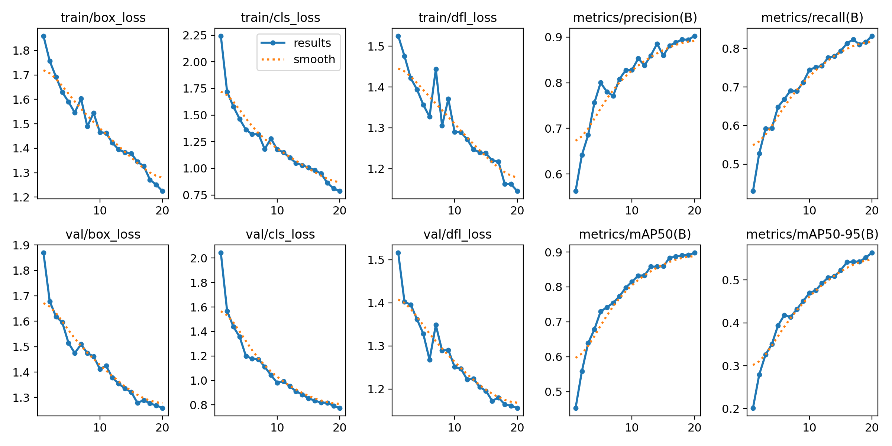
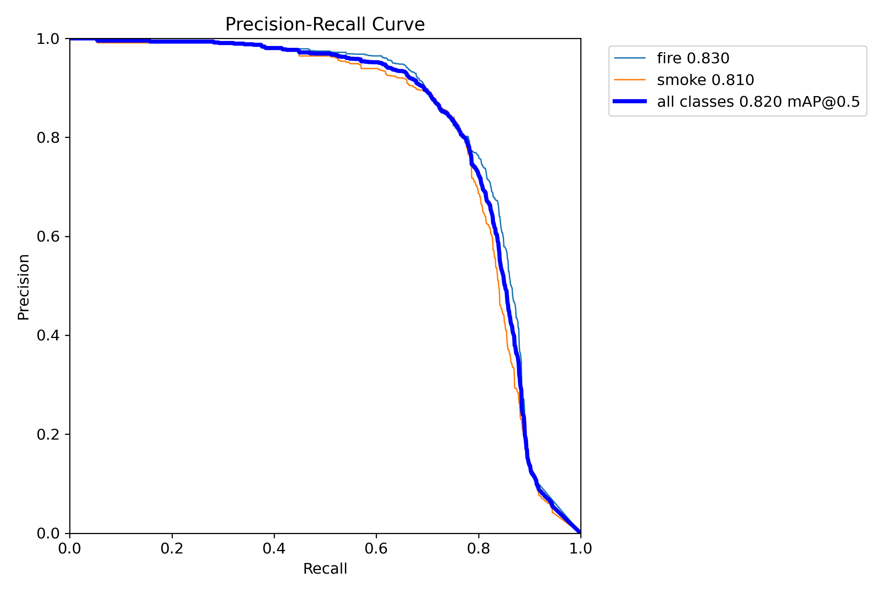
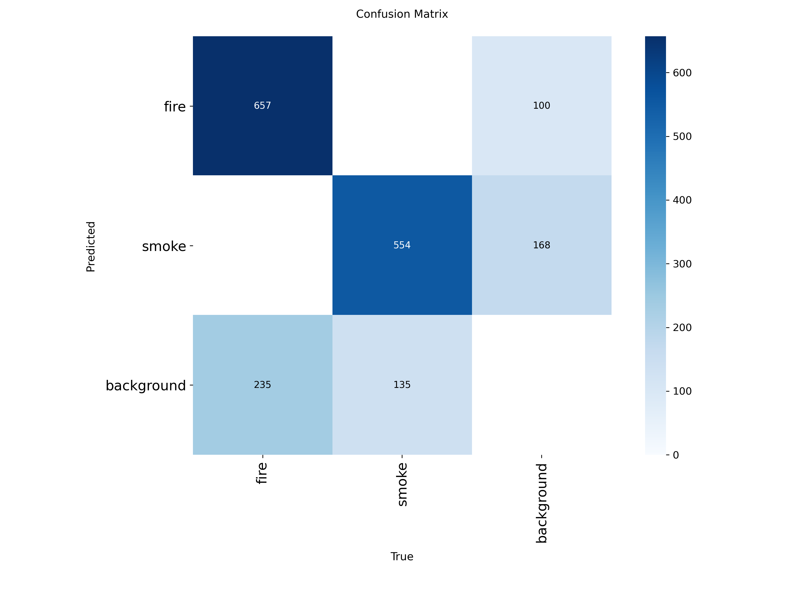
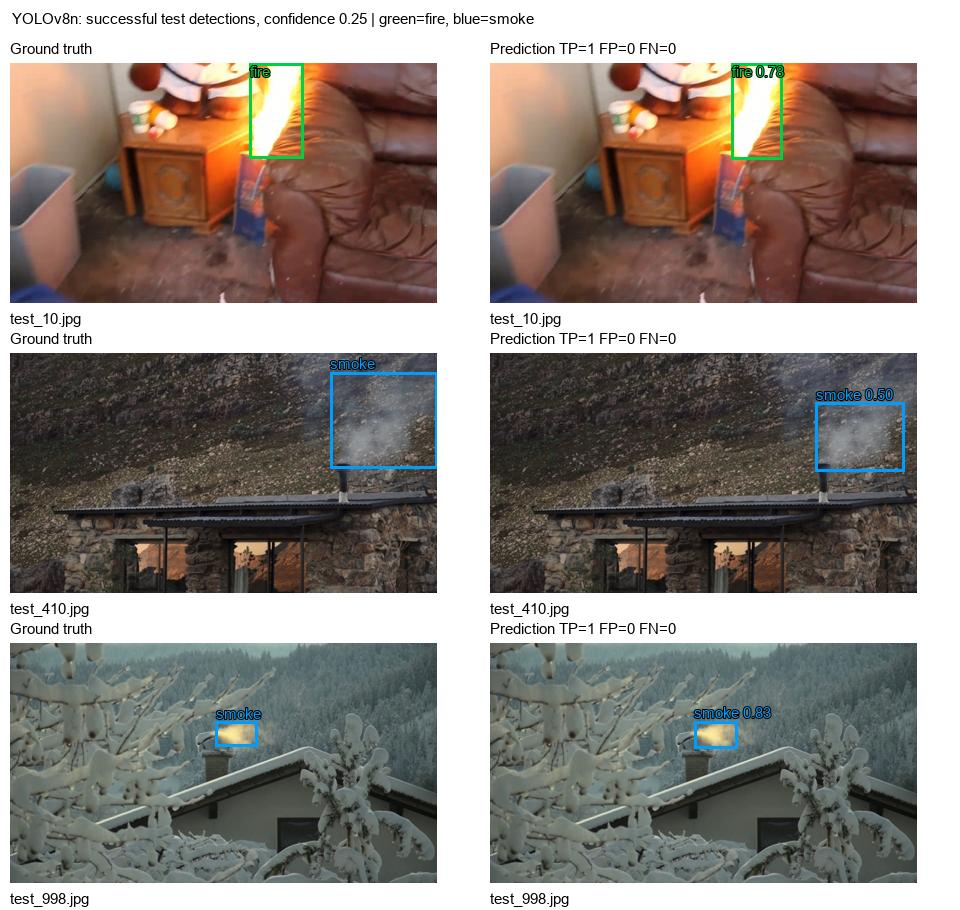
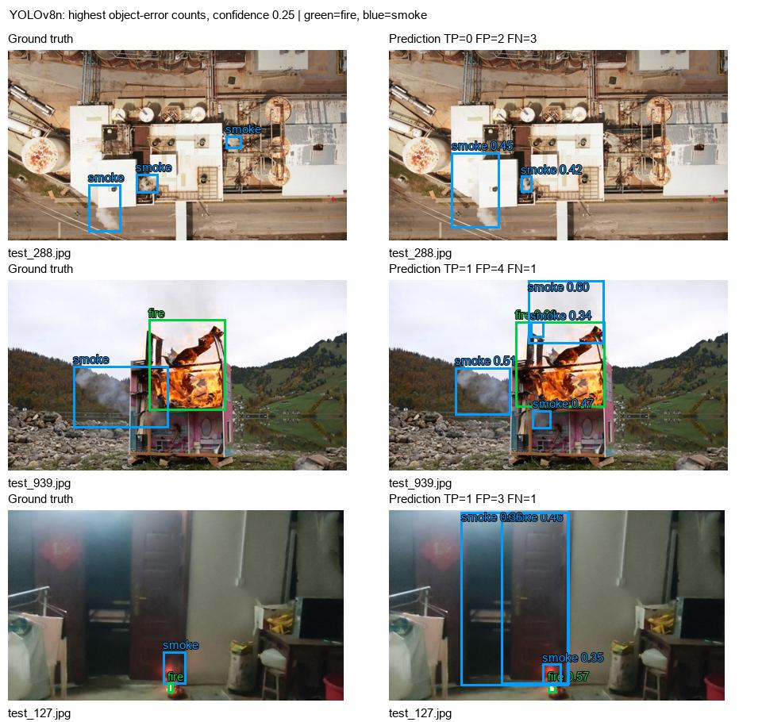
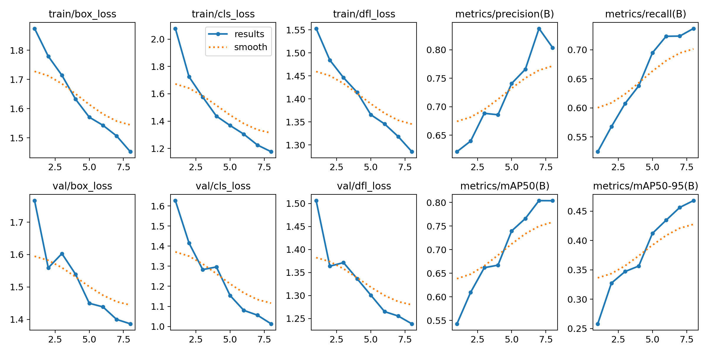
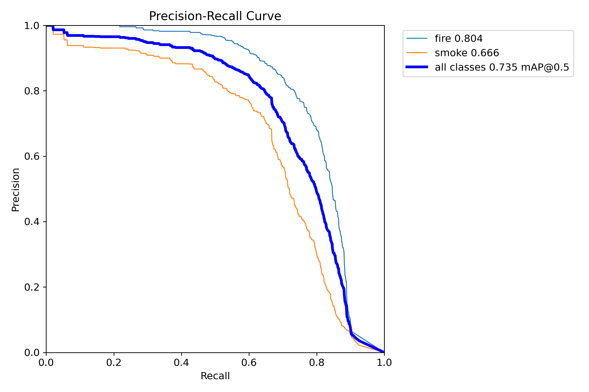
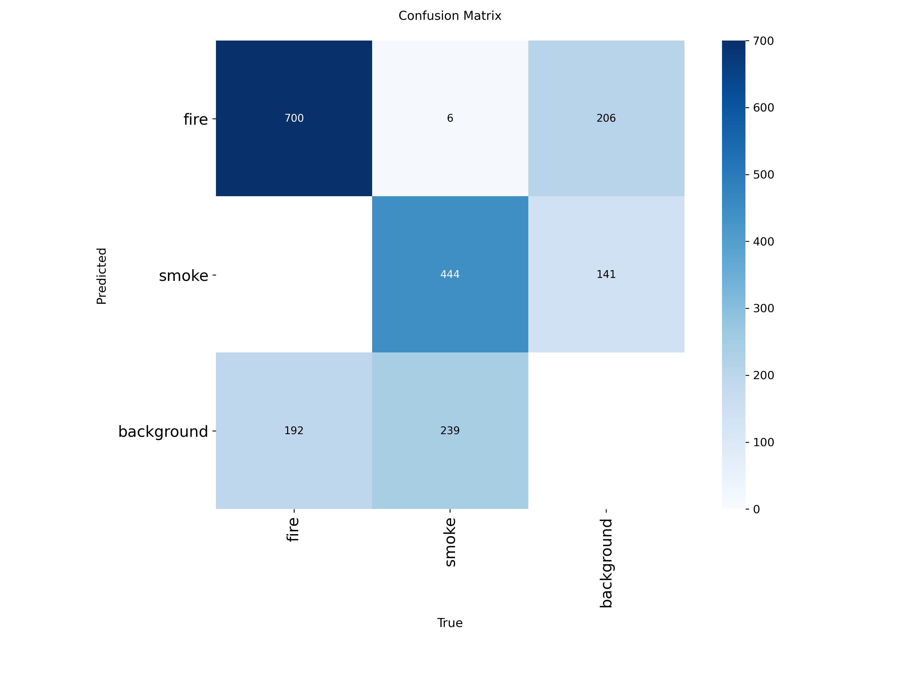
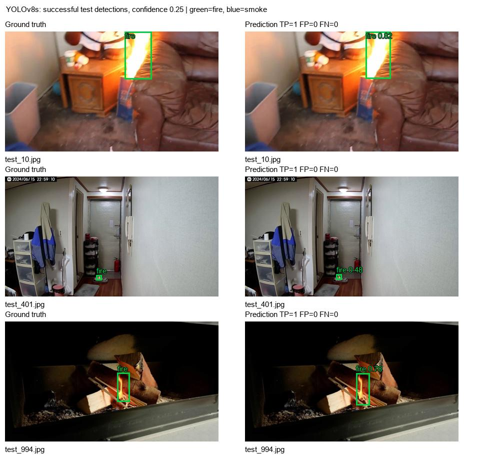
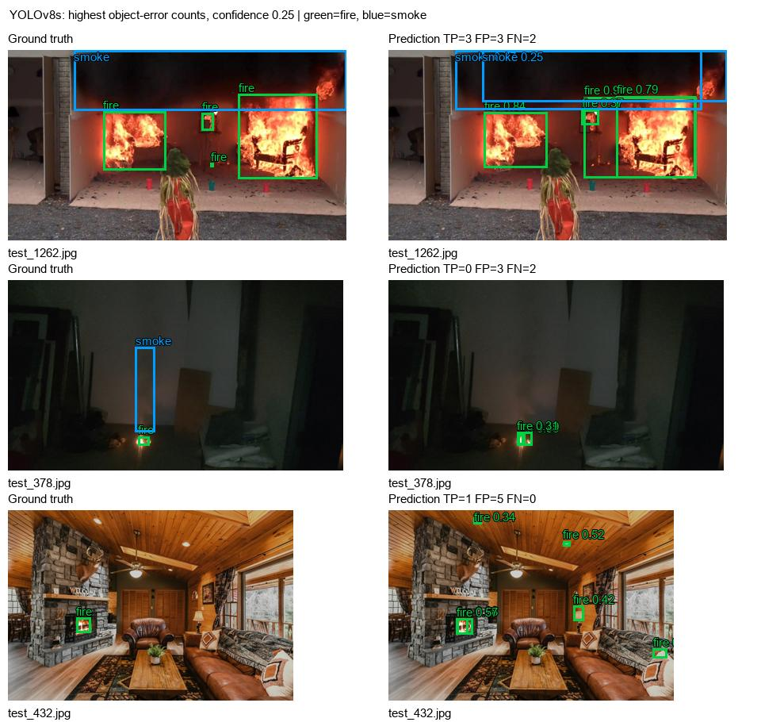

# FireSense AI: YOLOv8 Fire and Smoke Detection

Final experimental report | 26 October 2026 | Academic research prototype

## Objective and starting state

Build a reproducible two-class detector for visible fire and smoke in images, uploaded videos and camera streams. The starting workspace was empty: no implementation, model, dataset, requirements, tests or Git history existed. The supplied 23-page R&D proposal (evidence/starting_proposal.pdf) explicitly described experiments as not yet performed. Its intended system combines localization, temporal event confirmation, local/email alerts and a virtual sprinkler simulation.

This delivery implements the detector experiment and runnable training/inference/evaluation requested in the current task. The document is contextual research material; its instructions do not override the user request. Email services, event policy calibration and virtual suppression are future extensions, not measured capabilities here.

## Dataset and provenance

Home Fire Dataset v1.0.0 by Bo Peng and Tae-Kook Kim was selected because its indoor fire/smoke localization task fits the monitoring prototype, its authors publish YOLO annotations and a held-out test partition, and 6,500 images fit local compute. D-Fire was considered but its larger collection would raise the local training cost. Source: https://github.com/PengBo0/Home-fire-dataset/releases/tag/v1.0.0 . The authors license the collection under Creative Commons Attribution-NonCommercial 4.0 International (CC BY-NC 4.0). Use is noncommercial and requires attribution. The authors describe collecting frames from public video platforms and volunteer material; original third-party media terms still matter for redistribution.

Citation: B. Peng and T.-K. Kim, "YOLO-HF: Early Detection of Home Fires Using YOLO," IEEE Access, vol. 13, pp. 79451-79466, 2025, doi:10.1109/ACCESS.2025.3566907. Class mapping: 0 = fire, 1 = smoke. Background is represented by an empty label file, not a third detection class.

| Split | Published images | Audited images | Fire boxes | Smoke boxes | Negative images |
| --- | --- | --- | --- | --- | --- |
| train | 3900 | 3873 | 2951 | 1834 | 87 |
| val | 1300 | 1297 | 960 | 617 | 33 |
| test | 1300 | 1295 | 892 | 689 | 15 |

The published split is 60/20/20. Auditing observed 6500 images, quarantined 33 inputs and removed 2 exact decoded-pixel duplicates. Duplicate priority is test, validation, then training: an image in test never remains in training. Labels must contain finite normalized class/x/y/width/height values, valid class IDs, positive dimensions and in-bounds boxes. Images are resized proportionally to at most 640 px and stored as quality-95 JPEG; YOLO then letterboxes them to 416 px. There is no generated data or offline augmentation. Archive hashes/URLs are in evidence/downloads.json; every retained image and label is listed in evidence/manifest.json; exclusions are in evidence/data_audit.json.

The audited test set contains only 15 negative images out of 1295 (1.16%). This positive-heavy benchmark provides limited evidence about nuisance alarms in long, mostly hazard-free camera streams.

In this run, all 33 quarantined inputs have non-default EXIF orientation. They were excluded conservatively because automatically rotating pixels without confirming the annotation coordinate convention can misalign boxes; this does not mean the source image is corrupt. Both exact duplicate removals occurred within the official test split. No exact decoded-pixel overlap was found between retained splits.

Both removed duplicate images had slightly different fire-box coordinates from the retained copy of the same pixels. The deterministic first-copy policy retains one original annotation rather than averaging or relabeling test boxes. This is evidence of some annotation variation, which can matter at strict IoU thresholds; it does not quantify annotation noise across the full collection. Pair IDs are saved in evidence/duplicate_annotation_check.json.

The official split is retained rather than claiming a new scene-independent benchmark. Exact pixel hashes do not catch near duplicates, alternate encodings or adjacent video frames. A dependable frame-to-source-video map was not available; scene overlap is therefore an unresolved risk. The test set is held out from optimization, but is not demonstrated to be independent of training scenes. These results must not be presented as unseen-camera or early-warning performance.

## Method and configuration

Both detectors use official COCO-pretrained YOLOv8 weights, replacing the detection head for two classes and fine-tuning the network. Nano is the primary low-cost baseline; small tests whether additional capacity improves accuracy. Both share the same data, seed, input resolution, optimizer and originally configured 20-epoch learning-rate schedule. Nano completed 20 epochs; small completed 8 before the user requested faster completion. Nano began with batch 8 and changed to batch 4 after epoch 8 following resource failures; small uses batch 4 throughout. Gradient accumulation targets nominal batch 64. With unequal completed training budgets, this is a practical comparison of delivered checkpoints, not evidence that one architecture is inherently superior. The small run was still learning when stopped. This is one run per size, without hyperparameter search or repeated-seed confidence intervals.

The nano run was interrupted just after epoch 6 by Windows error 1450 (insufficient system resources) during a filesystem existence check. The same check subsequently succeeded and the JPEG remained readable. A later CUDA out-of-memory error interrupted epoch 9. Training was resumed from last.pt with native model, optimizer and completed-epoch recovery, reducing batch size to 4 for the second recovery. Partial work in the interrupted epochs was discarded. No data labels or operating-system policy were altered. This interruption may change the stochastic training trajectory relative to a completely uninterrupted run; original and recovery logs are retained in evidence/.

| Setting | Value |
| --- | --- |
| Models | YOLOv8n and YOLOv8s |
| Input / batch | 416 x 416 / 4 (nano epochs 1-8 used 8) |
| Budget / early stopping | Nano: 20 completed; small: 8 completed of 20 planned / patience 8 |
| Optimizer / learning rate | AdamW / 0.001 initial, final multiplier 0.01 |
| Weight decay / warmup | 0.0005 / 2 epochs |
| Seed / loader workers | 42 / 0 |
| Precision | FP32; AMP disabled for the GTX 1650 |
| Augmentation | HSV h=.015, s=.7, v=.4; translation .1; scale .5; horizontal flip .5 |
| Other transforms | Mosaic 1.0; nano off at epochs 18-20; small stopped before off phase; mixup/vertical flip/rotation 0 |
| Checkpoint selection | Best validation fitness under pinned Ultralytics version |
| AP evaluation | Confidence floor .001; NMS IoU .7; IoU thresholds .50:.05:.95 |
| Operational P/R | Fixed confidence .25; NMS IoU .7; class-aware matching at IoU .5 |

The 4 GB NVIDIA GTX 1650 motivated 416 px, batch 4 and nano/small models. The 20-epoch primary run and 8-epoch comparison are local baselines and do not establish convergence. The comparison was cut short on the user's explicit speed request, retaining the latest fully completed checkpoint and discarding partial epoch 9 work. Full precision avoids depending on mixed-precision behavior on this older GPU. Exact resolved defaults and configuration are saved in runs/train/*/args.yaml and evidence/train_*.json.

Environment: Python 3.12.14; PyTorch 2.5.1+cu121; Ultralytics 8.3.221; GPU NVIDIA GeForce GTX 1650. Windows initially blocked DLLs in the newest scientific packages; pinned older wheels were installed and verified. No operating-system security policy was changed. Full package inventory is evidence/environment_freeze.txt.

## Evaluation protocol and measured results

Neither training nor checkpoint selection uses the test partition. Recommendation is locked from validation mAP@0.5:0.95 before testing. The confidence threshold 0.25 was fixed in code before test evaluation; it is a baseline operating threshold, not a calibrated probability of a fire event. AP uses the low-confidence predictions to integrate over the precision-recall curve.

Precision is the fraction of accepted predictions that correctly match a labeled box. Recall is the fraction of labeled objects detected. AP@0.5 accepts moderate localization overlap; AP@0.5:0.95 averages increasingly strict overlap thresholds and penalizes loose boxes. The table reports micro-averaged operational precision/recall and mean AP across the two classes.

| Model | Test precision | Test recall | Test mAP@0.5 | Test mAP@0.5:0.95 |
| --- | --- | --- | --- | --- |
| YOLOv8n | 80.46% | 75.27% | 82.02% | 47.22% |
| YOLOv8s | 74.35% | 70.40% | 73.50% | 39.17% |

| Model / class | Precision (.25) | Recall (.25) | AP@0.5 | AP@0.5:0.95 | TP / FP / FN |
| --- | --- | --- | --- | --- | --- |
| YOLOv8n / fire | 85.60% | 72.65% | 83.00% | 48.23% | 648 / 109 / 244 |
| YOLOv8n / smoke | 75.07% | 78.66% | 81.04% | 46.21% | 542 / 180 / 147 |
| YOLOv8s / fire | 74.89% | 76.57% | 80.35% | 44.67% | 683 / 229 / 209 |
| YOLOv8s / smoke | 73.50% | 62.41% | 66.65% | 33.68% | 430 / 155 / 259 |

Fixed-threshold counts use confidence-ordered, one-to-one matching of predictions to same-class ground truth at IoU >= 0.5. They reuse the evaluator's retained JSON predictions, with one-based exported categories converted back to zero-based classes. Native export rounds coordinates to three decimals and scores to five; the fixed threshold is applied to these exported scores. Duplicate detections become false positives, and wrong classes can produce both an FP and an FN. The native Ultralytics best-F1 precision/recall are retained in the JSON evidence for transparency; they use a test-curve-selected operating point and are not substituted for the pre-fixed threshold figures above. Native confusion matrices use confidence 0.25 and the pinned evaluator's IoU=0.45 matching; therefore their counts need not equal the stricter IoU=0.5 fixed-threshold table. AP and operational counts are complementary measures.

## Model comparison and recommendation

| Model | Validation mAP50-95 | Parameters | Best weights MB | Test forward ms/image |
| --- | --- | --- | --- | --- |
| YOLOv8n | 56.41% | 3,006,038 | 6.20 | 7.35 |
| YOLOv8s | 46.83% | 11,126,358 | 22.49 | 8.96 |

Recommendation: YOLOv8n, selected by the highest validation mAP@0.5:0.95 (56.41%). This selection was saved before test evaluation in evidence/recommendation.json. The table makes the capacity and latency cost visible; nano also requires fewer parameters and less weight storage. The accuracy ranking applies to these delivered checkpoints with unequal completed training budgets. Test scores describe the locked choice and do not drive another round of tuning. Forward latency is the evaluator's measured batch-8 GPU average; it excludes capture, drawing, encoding and application overhead and must not be advertised as live camera FPS. The machine was shared with other workloads and experienced CPU/RAM pressure (evidence/resource_pressure.txt); these single timing runs are descriptive, not an isolated speed benchmark. Neither size is proven optimal. In particular, the shorter small-model run cannot establish its fully trained potential.

## Learning curves and diagnostic figures

### YOLOv8n

Completed 20 epochs. Best checkpoint SHA256: 921ebd5b6a77f4e1e1131718587046179dba693d77c2889d154b0125bcbcb576.

### YOLOv8s

Completed 8 epochs. Best checkpoint SHA256: 6c87f348c3ae211167de1fdf6b4b8cec93c0cb70011fb200a90b7e5e9eed7c7b.

## Error analysis and practical implications

The galleries display actual held-out frames with ground truth beside predictions. Failure examples are ranked by FP+FN object count at confidence 0.25, rather than selected to flatter the model. Per-image labels, predictions and TP/FP/FN are saved in each evaluator's image_results.json; failure_examples.json lists the worst ten. A missed smoke plume or small flame is relevant to the monitoring objective; false boxes would become nuisance candidates if every frame triggered an alert. Localization AP does not measure incident confirmation, false alarms per hour or detection delay.

The label vocabulary describes visible flame and smoke, not emergency severity. Controlled flames and candles can be correct fire detections under these annotations. A separate event/context policy is needed before a detector output can reasonably become an emergency alarm.

Nano's validation mAP@0.5 was 89.79%, while its test result is 82.02%; stricter mAP drops from 56.41% to 47.22%. This gap shows that validation scores would overstate performance on this held-out split. It is consistent with a distribution difference and/or overfitting, but this experiment cannot separate those causes.

At the fixed 0.25 confidence threshold, nano's fire recall is 72.65%: 244 of 892 annotated fire boxes are missed. Smoke recall is 78.66%, with 147 missed boxes; smoke precision is 75.07%, with 180 false-positive boxes. Missed small flames are a concern for the intended monitoring task, while extra smoke boxes could become nuisance candidates in an alert pipeline. These are object-level errors, not measured incident false alarms or missed fire events.

The nano failure gallery includes test_288 (0 TP, 2 FP, 3 FN): smoke boxes are missing or do not sufficiently overlap the three annotated plumes. A loose box can count as both FP and FN even when it points toward a real plume. In test_939 the model produces several additional smoke boxes that do not match the annotations. In test_127, tall smoke predictions cover doorway/background regions while the true labeled smoke region is small. These examples support weaknesses in small-object localization and diffuse-smoke/background separation.

The shortened small model is substantially weaker on smoke: test smoke AP@0.5 is 66.65%, versus nano's 81.04%. Its gallery includes small flame misses in test_1262, missed/misaligned objects in the dark test_378 frame, and five extra fire boxes on fixtures or background surfaces in the warm-toned test_432 room. The model does correctly detect the annotated fireplace in that last image, so an image-level success label would hide its extra boxes.

Nano is recommended for this delivery because it has the better locked validation score, better test results for the delivered checkpoints, fewer parameters and smaller weights. The comparison does not prove nano is intrinsically better than small: nano completed 20 epochs and small only 8 after the explicit speed request. Completing the small run and using repeated, source-disjoint trials could change the ranking. No test result was used to change weights or tune the operating threshold.

## Reproduction and delivered assets

Use the documented commands in README.md. Training: `.venv/Scripts/python.exe pipeline.py train --size n --epochs 20`. Comparison: change size to s. Evaluation: `.venv/Scripts/python.exe evaluate.py --split test` (after the validation selection command). Inference: `.venv/Scripts/python.exe pipeline.py predict --source IMAGE_OR_VIDEO`. A source of 0 selects the webcam. Data download and preparation each have a single command. requirements.txt pins the scientific stack; environment_freeze.txt captures the complete installed environment.

Verification: six unit tests pass, and the documented validation/test commands completed for both checkpoints. The inference CLI completed on a held-out still image and a 15-frame MP4 made from three test stills. The latter verifies video decoding, streamed inference and annotated video writing; it is not a temporal/event benchmark. Its sources are recorded in evidence/demo_provenance.json. Live webcam input was not tested.

Best trained weights are models/yolov8n_best.pt and models/yolov8s_best.pt. Training runs include best.pt, last.pt, results.csv, args.yaml and figures. Evaluation directories include native AP predictions, PR curves, confusion matrices, galleries and machine-readable summaries. Data binaries and weights are retained locally and excluded from Git; copy the entire project folder to preserve them. A clone alone is not the full binary delivery.

## Limitations and next steps

This is a two-class visual research baseline, not a certified life-safety detector. Smoke can resemble steam, fog or low-contrast backgrounds; fire can resemble warm lights and reflections. Occluded, tiny or out-of-distribution hazards may be missed. No site-specific hard-negative video set, event annotations, cross-dataset trial, repeated-seed analysis, probability calibration or full live-camera system benchmark was performed. Published video-derived splits may overestimate independent-scene performance. Absence of a detection does not establish a safe scene.

Next: build source-video/camera-disjoint splits and a hard-negative set; train longer at 640 px with multiple seeds; choose an operating threshold from validation cost/recall requirements; measure false alarms per hour and time-to-alarm on annotated videos. Then implement and separately test the proposal's temporal event gate, local/email alerts and software-only sprinkler simulation. No claim of novelty, real suppression accuracy or certified early warning follows from these detector results.

## Sources

Dataset and release: https://github.com/PengBo0/Home-fire-dataset ; https://github.com/PengBo0/Home-fire-dataset/releases/tag/v1.0.0 . Training API: https://docs.ultralytics.com/modes/train/ . Validation API: https://docs.ultralytics.com/modes/val/ . YOLOv8: https://docs.ultralytics.com/models/yolov8/ . Ultralytics license: https://www.ultralytics.com/license . Local primary evidence: evidence/, models/, runs/train/ and runs/eval/.
