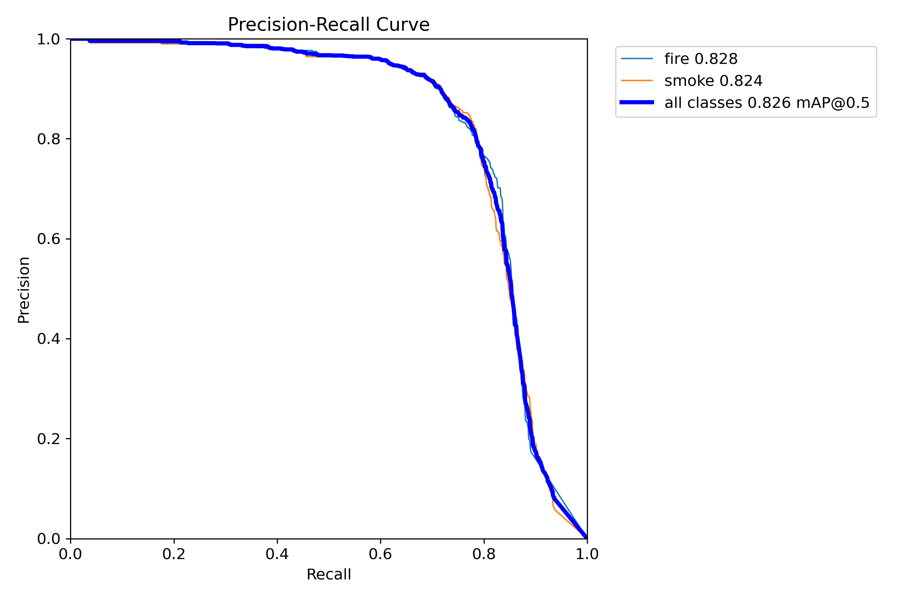
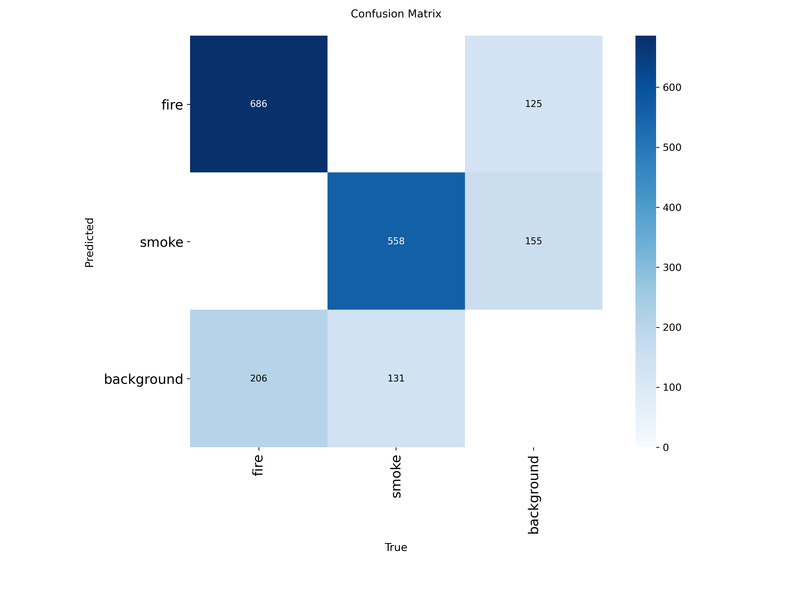

# Detector optimization and confidence audit

A confidence score is a per-box model output, not proof of correctness. Scores have not been rescaled, rounded up to a floor or fabricated. The 90%+ control only filters boxes. Higher thresholds can hide real hazards.

## Validation comparison

All configurations use the same 1,297 validation images. Selection uses validation only. NMS IoU is 0.70; fixed-threshold matching requires the correct class and a one-to-one IoU >= 0.50.

| Configuration | Input | mAP50 | mAP50–95 | Precision at 0.50 | Recall at 0.50 |
|---|---:|---:|---:|---:|---:|
| Original | 416 | 89.79% | 56.41% | 94.25% | 77.93% |
| Larger input | 512 | 89.05% | 54.96% | 92.72% | 79.20% |
| Larger input | 640 | 86.08% | 50.70% | 89.91% | 78.00% |
| Four-epoch refinement | 416 | 90.22% | 57.00% | 93.23% | 81.17% |

Selected checkpoint: **models/yolov8n_refined.pt** at 416 pixels. Validation mAP50-95 improvement and precision at 0.50 >= 90%; never select using test. SHA256: `148ca12996cde2a532d873a80bb94f519bc05e09d0887b6635aa78c83ffbb235`.

## Training configuration

Warm start from the original 20-epoch nano checkpoint; 4 additional epochs on all 3,873 training images, 416 pixels, batch 16, AdamW lr0=0.00015, lrf=0.1, weight decay=0.0005, warmup 1 epoch, seed 42, deterministic execution, FP32 on GTX 1650. Freeze backbone layers 0–9; train neck/head. Mosaic/mixup disabled; scale=0.2, translate=0.05, fliplr=0.5, HSV h/s/v=0.015/0.4/0.3. Other settings are recorded in the run args.yaml. Select the best epoch by native validation fitness. An initial batch-4 attempt was stopped during its first epoch for throughput; it did not supply a checkpoint. Original weights are preserved.

## Score thresholds on the existing test set

The test set has 1,295 images and 1,581 labeled objects. It was already evaluated in the original project. This follow-up is a reused benchmark, not a new independent generalization study. No test results select the checkpoint.

Refined test mAP50: **82.62%**; mAP50–95: **48.53%**. Original test values were 82.03% and 47.22%.

| Checkpoint | Min score | Precision | Recall | TP | FP | Missed objects |
|---|---:|---:|---:|---:|---:|---:|
| Original | 0.25 | 80.46% | 75.27% | 1190 | 289 | 391 |
| Original | 0.5 | 93.15% | 64.52% | 1020 | 75 | 561 |
| Original | 0.9 | 100.00% | 3.73% | 59 | 0 | 1522 |
| Refined | 0.25 | 80.25% | 77.36% | 1223 | 301 | 358 |
| Refined | 0.5 | 92.15% | 68.31% | 1080 | 92 | 501 |
| Refined | 0.9 | 100.00% | 4.81% | 76 | 0 | 1505 |

Per-class results at the recommended 0.50 threshold:

| Checkpoint | Class | Precision | Recall |
|---|---|---:|---:|
| Original | fire | 95.56% | 62.67% |
| Original | smoke | 90.39% | 66.91% |
| Refined | fire | 93.33% | 65.92% |
| Refined | smoke | 90.77% | 71.41% |

At 0.50, precision changes from 93.15% to 92.15%, while recall changes from 64.52% to 68.31%. Refinement improves recall/localization with a small precision tradeoff; it does not uniformly improve every class or image.





The native confusion matrix uses validator settings; fixed-threshold counts in the tables are computed separately.

100% observed precision at 0.90 is based on very few retained detections, with most objects missed. It does not mean perfect safety or accuracy. Use 0.50 as the default for fewer false detections; use 0.25 when recall matters more. The 90%+ filter is available explicitly, with a missed-detection warning.

## Reproduction and evidence

```powershell
.venv/Scripts/python.exe scripts/optimize_detector.py
.venv/Scripts/python.exe scripts/optimize_detector.py --finetune
.venv/Scripts/python.exe scripts/report_optimization.py
```

Only after the validation selection is locked, evaluate the refined checkpoint with `scripts/optimize_detector.py --weights models/yolov8n_refined.pt --sizes 416 --split test`. Rebuild this report afterward. Runs are uniquely named on repeats. Native curves, confusion matrices and prediction JSON are under runs/optimization; summary JSON and logs are under evidence/optimization_*. Original benchmark and data licensing remain in FINAL_REPORT.md.

No probability calibration, deployment-specific camera validation or independent incident-video safety testing was performed. Smoke and small/obscured objects remain challenging. Further improvement needs deployment-like labeled examples and hard negatives, not a higher displayed score.

The included sample image still receives a raw fire score around 77% after refinement; at 0.90 it has no retained box. This is expected filtering, not evidence that the scene is safe.

Metric definitions: [Ultralytics metrics](https://docs.ultralytics.com/guides/yolo-performance-metrics/). Threshold behavior: [Ultralytics predict settings](https://docs.ultralytics.com/modes/predict/).
