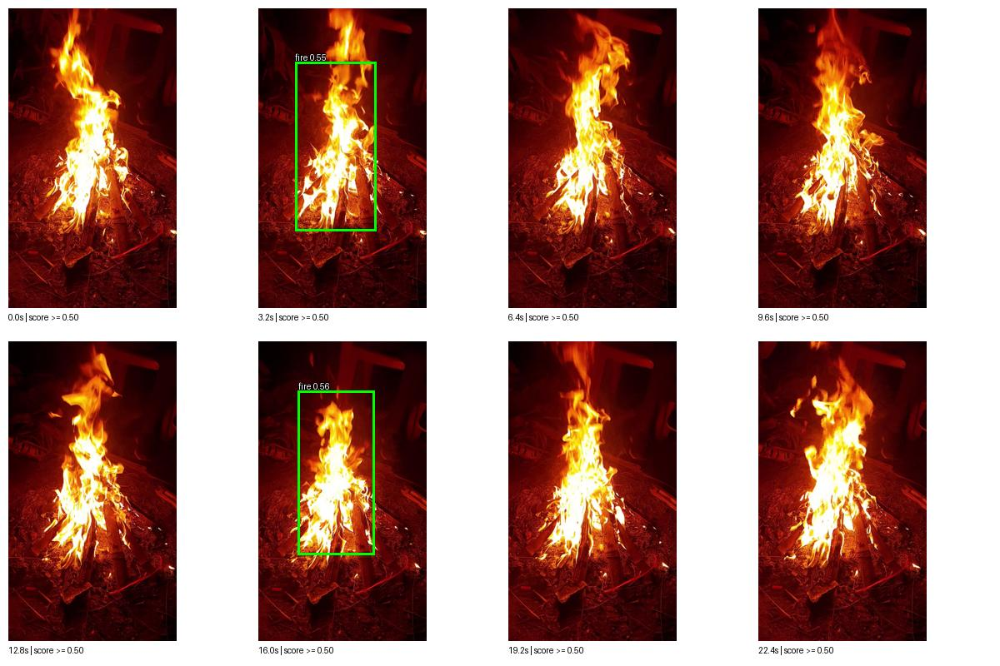
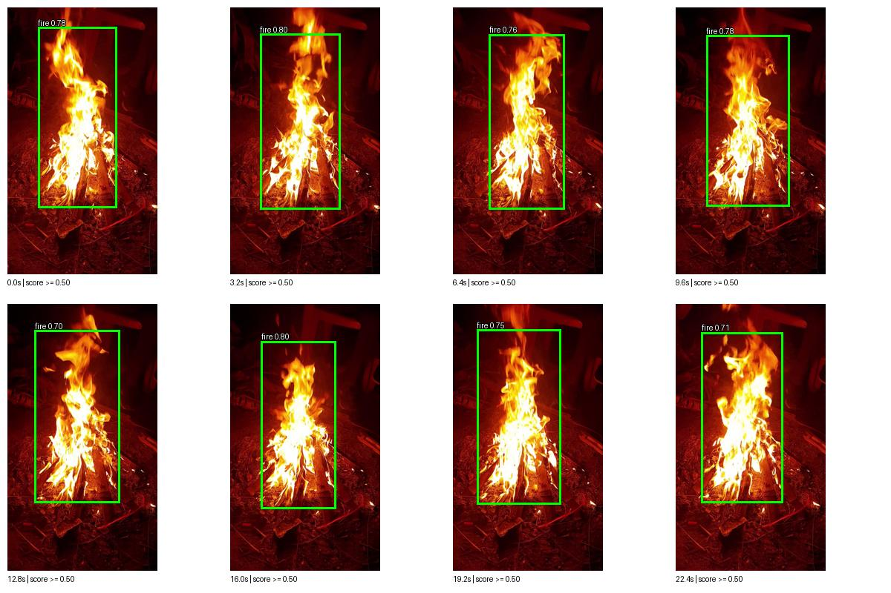

# Close-up fire video investigation and adaptation

Video: `6401825-hd_1080_1920_30fps.mp4`. 22.43 seconds, 1080×1920, 30 fps, 673 frames. SHA256: `304197e3a9160ecf2a477c601b6d8e85dae49ffc9a10b5916e7522b5099b3665`.

## Reproduced failure

The video visibly shows large flames in strong red lighting. At the dashboard's 0.50 minimum score, the refined nano model retained a fire box in only **2/8 fixed sampled frames**. The actual browser replay returned fire on **21/130 analyzed frames**. Requests succeeded; the failure was in detection coverage, not browser decoding. Larger inference sizes, gray-world balancing, CLAHE and grayscale preprocessing did not resolve it. Those image transformations were not deployed.

## Change

Created 600 close-up/portrait variants from the original training split only, preserving transformed fire/smoke boxes. Crops expand the largest annotated fire region by random 10–30% context, clip intersecting boxes, and resize to 360×640. Half receive randomized red-light channel gains. Source data and licensing remain the Home Fire Dataset, CC BY-NC 4.0.

The resulting training manifest contains 3,873 original images plus 600 variants (4,473 images). Neither this video nor original validation/test images were used for training. The augmentation manifest identifies every source image and crop. Annotation conversion is unit tested.

Started from the previous refined nano weights; trained 3 additional epochs at 416 pixels, batch 16, FP32, AdamW lr0=0.0002, lrf=0.1, weight decay 0.0005, 1 warmup epoch, seed 42. Parameters in the first four layers are frozen. Mosaic/mixup disabled; scale=0.15, translate=0.05, fliplr=0.5, HSV h/s/v=0.005/0.2/0.2. The run and all remaining settings are in `evidence/user_video/adaptation_training.json`. An initial batch-8 attempt was stopped before a completed epoch for throughput; it did not supply this checkpoint.

## Selection and leakage limits

The acceptance contract was saved before final candidate evaluation: validation mAP50–95 >= 0.55, precision at score 0.50 >= 0.90, and retained fire boxes aligned with flames in all eight sampled development frames. The contract allowed and disclosed up to about two percentage points of validation localization regression for close-up recovery. In fact, final validation mAP50–95 remained essentially unchanged. Test results did not select the checkpoint.

This clip was excluded from training, but it was inspected and used to select the candidate. It is therefore **development evidence**, not an independent unseen-video benchmark. Nearby frames are correlated. No frame-by-frame ground-truth boxes were drawn; sampled boxes were visually reviewed. Fire-positive frame coverage is not object-detection accuracy or proof of no false positives.

## Fixed-frame and browser results

| Check | Previous refined nano | Domain-adapted nano |
|---|---:|---:|
| Same 8 fixed frames with fire box at score >= 0.50 | 2/8 | 8/8 |
| Full browser replay: fire-positive / analyzed frames | 21/130 | 175/175 |

The browser samples adaptively after each inference, so the two replays process different frame counts. Use the fixed-frame row for a directly matched comparison. The full replay is an operational check, not a standardized accuracy estimate. All replay API requests returned 200; no browser page errors were recorded. Scores were not rescaled. The eight final samples scored about 0.70–0.80.

### Before



### After



## Original benchmark comparison

Validation: 1,297 images. Existing test: 1,295 images and 1,581 labeled objects. This test set was previously evaluated, so it is a reused benchmark. All model evaluations use 416 pixels, FP32, NMS IoU 0.70; fixed-threshold matching is class-aware, one-to-one IoU >= 0.50. mAP is computed with the native low-score evaluation sweep, separately from the 0.50 filtering table.

| Split/model | mAP50 | mAP50–95 | Precision at 0.50 | Recall at 0.50 |
|---|---:|---:|---:|---:|
| Validation / Previous | 90.22% | 57.00% | 93.23% | 81.17% |
| Validation / Adapted | 90.77% | 57.01% | 92.79% | 80.85% |
| Test / Previous | 82.62% | 48.53% | 92.15% | 68.31% |
| Test / Adapted | 83.74% | 48.35% | 93.04% | 68.50% |

Test per class, adapted model:

| Class | AP50 | AP50–95 | Precision at 0.50 | Recall at 0.50 |
|---|---:|---:|---:|---:|
| fire | 83.33% | 48.23% | 93.36% | 67.83% |
| smoke | 84.15% | 48.46% | 92.64% | 69.38% |

Test mAP50 improves from 82.62% to 83.74%; mAP50–95 decreases slightly from 48.53% to 48.35%. This is not a uniform improvement: fire localization AP50–95 decreases, while smoke improves. Additional independent clips and hard negatives are still needed.

## Run and reproduce

The active profile is `evidence/optimization_selection.json`; weights are `models/yolov8n_domain.pt`, SHA256 `4d9b2ce49bcf61694427e1e756b2e66ed5005d6552cb999950de2ceccdf64b41`. Dashboard and default CLI inference read that profile. Earlier checkpoints remain available. Refresh http://localhost:8765, upload the same video, and keep the minimum score at **50%**. A 90% filter would hide many correct detections; a 90% score is not required for correctness.

```powershell
.venv/Scripts/python.exe scripts/adapt_detector.py
.venv/Scripts/python.exe scripts/adapt_detector.py --train
.venv/Scripts/python.exe scripts/optimize_detector.py --weights models/yolov8n_domain.pt --sizes 416
.venv/Scripts/python.exe scripts/review_video.py --video "C:\Users\Karth\Downloads\6401825-hd_1080_1920_30fps.mp4" --weights models/yolov8n_domain.pt --tag reproduced_review
.venv/Scripts/python.exe dashboard.py
```

Preparation and training create candidate artifacts; they do not automatically deploy a rerun. When weights already exist, training prints a separate candidate path and preserves the deployed file; evaluate that printed path to review a rerun. Native validation/test curves, confusion matrices and prediction JSON are under `runs/optimization/val_yolov8n_domain_416` and `test_yolov8n_domain_416`. Browser response evidence is under `evidence/user_video/`. Thirteen unit tests pass, including crop/annotation remapping and deployment validation. Rollback: restore `evidence/user_video/previous_deployment.json` to `evidence/optimization_selection.json` and restart the dashboard.

Remaining limits: no independent new-video test after adaptation; no calibrated event alarm or safety certification; no physical webcam validation. The positive-only clip cannot establish false-positive performance. Broader camera/lighting/night/background coverage and independent scene splits are the next useful data work.
